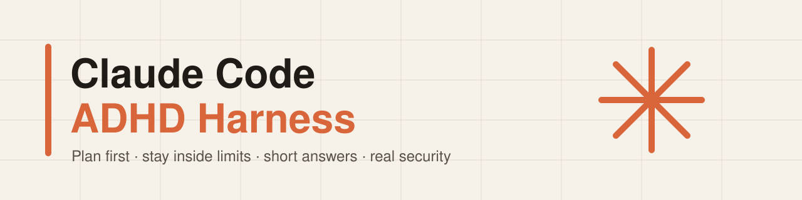
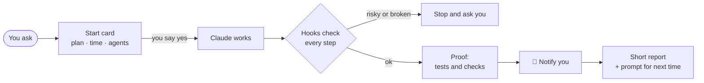

<picture>
  <source media="(prefers-color-scheme: dark)" srcset="assets/banner-dark.svg">
  
</picture>

<p align="center">
  <b>Rules, hooks and skills that keep Claude Code in check —<br>
  it asks before risky things, never runs away with your computer or your tokens,<br>
  and talks to you in short bullets first.</b>
</p>

<p align="center">
  
  
  
  
  
</p>

---

## Why this exists

Out of the box, an AI coding agent can be *too* eager. Without limits, a single session can:

- launch **13 helper agents at once** and nearly freeze a 16 GB computer,
- keep working for **9 hours** on its own because nothing told it to stop,
- burn through a whole plan's tokens on work nobody asked for,
- answer in long walls of text that are hard to read with ADHD.

This harness fixes that. Claude **shows a plan and waits for a yes**, works inside a **time limit and a memory limit**, uses **as few agents as the job needs**, and puts **real security** first — explained in plain English, so you don't need years of experience to stay in control.

## What it does

| | |
|---|---|
| 🔍 **Explains before you approve** | Risky commands (delete, install, force-push, upload…) are held until Claude explains them part by part. |
| 🗂️ **Start card** | Plan + time limit + agents in one short card. One yes, then work starts. |
| 🧠 **Short answers** | Bullets first, details after. Ask once, then wait — no "still waiting…" spam. |
| 🛡️ **Real security** | Fixes safe problems first, ranks the rest Critical → Low. Never breaks into anything. |
| 🔑 **Secrets stay yours** | `.env` with empty values and click-by-click "where to get it" steps. Claude never opens it. |
| 💻 **Protects your computer** | No heavy work when memory is low; stops and tells you if it drops. |
| 🪙 **Saves tokens** | A small core file (~900 words); detailed rules load only when a task needs them. |
| ✅ **Proof, not promises** | Every "fixed" comes with the test that shows it. Errors are never hidden. |
| 🔔 **Notifications** | A pop-up when Claude needs you, finishes, or something breaks. |
| 📈 **Learns** | Repeated mistakes become short lessons; repeated requests become one-word skills. |

## How a task flows



## What's inside

```
CLAUDE.md             ⭐ the core rules, loaded every session (short on purpose)
harness-settings.md   your own settings — memory limits, agents, look of pages
rules/                one detailed file per topic, read only when needed
  01-communication · 02-permissions · 03-agents · 04-computer
  05-tokens · 06-security · 07-secrets · 08-git · 09-code
  10-notifications · 11-learning · 12-question-form
rules/design-rules.md visual rules, read only for interface work
skills/               25 step-by-step routines that load only when used
hooks/                21 automatic checks + a safe installer (see hooks/README.md)
tools/                screenshot tool, Figma reader, RESOURCES.md refresher, terminal status board (no packages needed)
STARTER-PACK.md       every hook and skill: what it does, and its status
RESOURCES.md          good tools by topic — design, security, code, Figma, Claude Code
DISCLAIMERS.md        please read before installing
```

### The 25 skills

| Group | Skills |
|---|---|
| **Planning and talking** | `plan-first` · `grill-me` · `owner-form` · `explain-command` · `explain-code` · `write-up` · `first-run-setup` |
| **Building** | `project-map` · `task-splitter` · `debug` · `verify` · `review-changes` · `merge-manager` · `pre-deploy-check` · `cleanup` |
| **Security** | `secure-code` · `security-check` · `package-check` |
| **Design** | `design-research` · `design-system` · `design-review` · `figma-to-code` |
| **Showing your work** | `project-showcase` · `resources-finder` · `improve-system` |

`review-changes` and `security-check` are named that way so they never clash with Claude Code's built-in `/code-review` and `/security-review`.

### The hooks

Safety: `explain-gate` · `block-dangerous` · `protect-secret-files` · `secret-scan` · `protect-config` · `github-check` · `require-remote`
Quality: `commit-guard` · `finish-check` · `review-gate` · `auto-format` · `dep-check`
Computer and cost: `ram-check` · `auto-push`
Memory and learning: `session-start` · `session-log` · `command-log` · `mistake-log` · `rules-refresh` · `notify`
Seeing which terminal needs you: `status-update` (feeds the status line and the status board)

What each one does, how to install them safely, and their limits: **[hooks/README.md](hooks/README.md)**.

## Status

This is a **first version**, built in the open. Everything marked ✅ exists in this repo; first versions are written and checked, but most have not been used for long in real projects yet.

| Part | Status |
|---|---|
| Core rules + 12 detailed rule files | ✅ first draft |
| Settings file | ✅ |
| Starter pack list (hooks + skills) | ✅ |
| Design rules | ✅ |
| Skills: all 25 written (first versions) | ✅ |
| Tools: screenshot tool (`shot.mjs`), Figma reader (`figma.mjs`) | ✅ |
| `RESOURCES.md` — tables of useful repos by topic | ✅ (the weekly auto-refresh is still 📝 planned) |
| Hooks (`hooks/` — 21 scripts + a safe installer) | ✅ |
| One-step install (`first-run-setup`) | ✅ first version — not yet tested end to end on a clean computer |
| **Terminal status board** — a coloured tile per open terminal (working / needs you / blocked) with the project's short name, plus a coloured status line inside each terminal (`tools/status-board.mjs`, `hooks/status-update.mjs`) | ✅ first version — the tab-title part is experimental |
| Automated test suite (`node --test`) and a GitHub check on every push | ✅ |

<details>
<summary><b>Install</b> (first version — click for the steps)</summary>

<br>

The `first-run-setup` skill:

1. asks a few questions — your computer's memory, your Claude plan, how pages should look,
2. checks which hooks and skills you already have,
3. explains each piece, and installs only what you say yes to.

Hooks have their own safe installer (`node hooks/install.mjs` — a dry run until you add `--apply`, with a backup of your settings). See `hooks/README.md`.

Everything goes into `~/.claude/harness/` — **not** `~/.claude/rules/`, because Claude Code
loads that folder automatically in every session, which would cost tokens all the time.

This is a first version that has not been tried on a clean computer yet. If you'd rather not run it, read the rules and copy what you like into your own `CLAUDE.md`.
</details>

<details>
<summary><b>Who is this for?</b></summary>

<br>

- People with ADHD (or anyone) who want short, scannable answers.
- Beginners who want an AI agent that explains before it acts.
- Anyone on a smaller plan or a normal laptop who can't afford runaway agents.
- Anyone who prefers to understand the plan before the work starts.
</details>

## Please read

These rules reduce risk — they don't remove it. Hooks run code on your computer, AI makes mistakes, and costs are yours. Full list: **[DISCLAIMERS.md](DISCLAIMERS.md)**.

Not affiliated with Anthropic.
