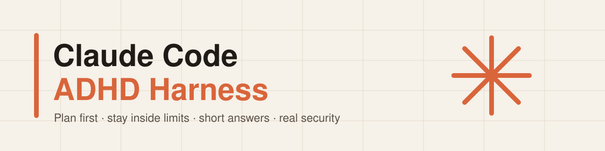
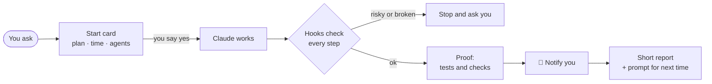

<picture>
  <source media="(prefers-color-scheme: dark)" srcset="assets/banner-dark.svg">
  
</picture>

<p align="center">
  <b>Rules, hooks and skills that keep Claude Code in check —<br>
  it asks before risky things, never runs away with your computer or your tokens,<br>
  and talks to you in short bullets first.</b>
</p>

<p align="center">
  
  
  
  
</p>

---

## Why this exists

Out of the box, an AI coding agent can be *too* eager. Without limits, a single session can:

- launch **13 helper agents at once** and nearly freeze a 16 GB computer,
- keep working for **9 hours** on its own because nothing told it to stop,
- burn through a whole plan's tokens on work nobody asked for,
- answer in long walls of text that are hard to read with ADHD.

This harness fixes that. Claude **shows a plan and waits for a yes**, works inside a **time limit and a memory limit**, uses **as few agents as the job needs**, and puts **real security** first — explained in plain English, so you don't need years of experience to stay in control.

## What it does

| | |
|---|---|
| 🗂️ **Start card** | Plan + time limit + agents in one short card. One yes, then work starts. |
| 🧠 **Short answers** | Bullets first, details after. Ask once, then wait — no "still waiting…" spam. |
| 🛡️ **Real security** | Fixes safe problems first, ranks the rest Critical → Low. Never breaks into anything. |
| 🔑 **Secrets stay yours** | `.env` with empty values and click-by-click "where to get it" steps. Claude never opens it. |
| 💻 **Protects your computer** | No heavy work when memory is low; stops and tells you if it drops. |
| 🪙 **Saves tokens** | A small core file (~900 words); detailed rules load only when a task needs them. |
| ✅ **Proof, not promises** | Every "fixed" comes with the test that shows it. Errors are never hidden. |
| 🔔 **Notifications** | A pop-up when Claude needs you, finishes, or something breaks. |
| 📈 **Learns** | Repeated mistakes become short lessons; repeated requests become one-word skills. |

## How a task flows



## What's inside

```
CLAUDE.md             ⭐ the core rules, loaded every session (short on purpose)
harness-settings.md   your own settings — memory limits, agents, look of pages
rules/                one detailed file per topic, read only when needed
  01-communication · 02-permissions · 03-agents · 04-computer
  05-tokens · 06-security · 07-secrets · 08-git · 09-code
  10-notifications · 11-learning · 12-question-form
rules/design-rules.md visual rules, read only for interface work
skills/               step-by-step routines that load only when used
tools/                screenshot tool + read-only Figma reader (no packages needed)
STARTER-PACK.md       every hook and skill: what it does, and its status
RESOURCES.md          good tools by topic — design, security, code, Figma, Claude Code
DISCLAIMERS.md        please read before installing
```

## Status

This project is being built in the open. Only what's marked ✅ exists today.

| Part | Status |
|---|---|
| Core rules + 12 detailed rule files | ✅ first draft |
| Settings file | ✅ |
| Starter pack list (hooks + skills) | ✅ |
| Design rules | ✅ |
| Skills: `design-research`, `design-system`, `design-review`, `project-showcase` | ✅ 4 of 25 |
| Tools: screenshot tool (`shot.mjs`), Figma reader (`figma.mjs`) | ✅ |
| `RESOURCES.md` — tables of useful repos by topic | ✅ (weekly auto-refresh 📝 planned) |
| Other 21 skills | 📝 planned |
| Hooks (cleaned for public use) | 📝 planned |
| One-step install (`first-run-setup`) | 📝 planned |

<details>
<summary><b>Install</b> (not ready yet — click for the plan)</summary>

<br>

When it's ready, a setup skill will:

1. ask a few questions — your computer's memory, your Claude plan, how pages should look,
2. check which hooks and skills you already have,
3. explain each piece, and install only what you say yes to.

Everything goes into `~/.claude/harness/` — **not** `~/.claude/rules/`, because Claude Code
loads that folder automatically in every session, which would cost tokens all the time.

Until then, you can read the rules and copy what you like into your own `CLAUDE.md`.
</details>

<details>
<summary><b>Who is this for?</b></summary>

<br>

- People with ADHD (or anyone) who want short, scannable answers.
- Beginners who want an AI agent that explains before it acts.
- Anyone on a smaller plan or a normal laptop who can't afford runaway agents.
- Anyone who prefers to understand the plan before the work starts.
</details>

## Please read

These rules reduce risk — they don't remove it. Hooks run code on your computer, AI makes mistakes, and costs are yours. Full list: **[DISCLAIMERS.md](DISCLAIMERS.md)**.

Not affiliated with Anthropic.
