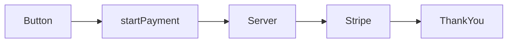

# Explain code

Goal: after reading your explanation, the user can **say it in their own words**. They may be learning, may be preparing to show the project to an employer, or may just need to decide something. Never talk down to them, and never skip the real mechanism just to sound simple.

Rules this follows: 1.1–1.3 (short first, details after), 1.6 (never fake), 9.1 (understand before explaining), 5.1–5.2 (search first, read only what's needed).

## Step 1 — Find the right code, cheaply

- Start from `PROJECT_MAP.md` if it exists. Search (`Grep`/`Glob`) for the names the user mentioned; read only the relevant parts.
- If the request is vague ("explain the project"), pick the entry point and the 3–6 most important files. Don't read everything.
- **Read before explaining.** Never explain code from its file name or from guessing. If you haven't read it, say so.

## Step 2 — Explain in layers

**Layer 1 — one sentence.** What it is for, in plain words, with no jargon.
> "This file decides what happens when someone presses the Pay button: it checks the cart, asks Stripe to charge the card, and shows a thank-you page."

**Layer 2 — the steps, in the order they happen.** Numbered, 3–7 steps. Name the real files and functions so the user can find them:
```
1. The button in `checkout.html` calls `startPayment()` (js/pay.js:12)
2. `startPayment()` sends the cart to the server at /api/pay
3. The server recomputes the price (never trusts the browser) …
```

**Layer 3 — details, only if useful.** Why it was built this way, what could go wrong, what to change to alter behaviour. Short.

Use a small picture when it helps: a 4–8 line ASCII flow or a Mermaid diagram:


## Step 3 — Translate jargon

Whenever a technical word appears, explain it **in the same sentence** the first time:
- "an API endpoint (an address on the server that does one job)"
- "state (the data the page is remembering right now)"
- "middleware (a step that runs before the real handler, like a security guard at the door)"

Use an everyday comparison only when it is accurate. A wrong analogy is worse than none.

## Step 4 — Be honest

- Say which parts you are **sure** about (you read the code) and which you **infer** (e.g. what an external service does).
- Point out real problems you noticed (bugs, security risks, dead code) in one short list at the end — as "Also noticed:", never fix them unasked (rule 5.5).
- If the code is confusing or contradicts itself, say that. Don't invent a tidy story.

## Step 5 — Check understanding (when the user is learning)

End with 1–2 short questions the user could answer to test themselves ("What would happen if the server trusted the price from the browser?"), or offer: "Want me to quiz you on this, or write a 3-sentence version you can use in an interview?"

## Don't
- Don't paste the whole file back.
- Don't change code while explaining.
- Don't claim you ran it unless you did.
