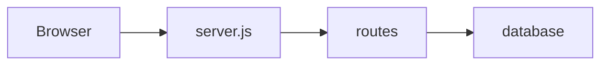

# Project map

Rules this follows: 5.3 (read the map first, keep it updated), 5.3a (finish-line check), 9.2 (one shared code style), 3.4–3.6 (agent roles and briefs), 7 (secret files are never listed with contents).

`PROJECT_MAP.md` is the cheapest way to understand a project: a short summary of each file is far cheaper than opening them all. **Read it first in every session** (rule 5.3). Keeping it correct is part of the work, not a separate job.

## A. Create it (once per project)

If `PROJECT_MAP.md` does not exist:

1. List files with the project's own tooling (`git ls-files`, or `Glob`). Skip: `node_modules`, build output, lock files, images/fonts (list as one line per folder), and secret files — **list `.env` by name only, never open it** (rule 7.4).
2. Read each real source file just enough to summarize it (top of file, exports, main functions). Small files: one line. Big or central files: 2–4 lines.
3. Write the three sections below. **No agent needed** — Claude does this itself.

````markdown
# Project map — <name>
Updated: <date> · Stack: <language/framework/tools> · Run: `<command>` · Test: `<command>`

## Files
| File | What it does |
|---|---|
| `src/server.js` | Starts the web server, loads routes, connects to the database. |
| `src/routes/orders.js` | Create/list/cancel orders. Checks the logged-in user owns each order. |
| `public/index.html` | Home page; loads `js/app.js`. |

## How the parts connect
(Mermaid or a short ASCII picture — 5–12 boxes, not more)


## How code is written here
3–5 tiny REAL examples copied from this project:
- Naming: `getUserOrders` (camelCase functions), `order-card.css` (kebab-case files)
- Errors: `try { … } catch (e) { return res.status(500).json({ error: 'message' }) }`
- Layout: one route file per resource in `src/routes/`
- Tests: `tests/<name>.test.js`, run with `npm test`
````

The **"How code is written here"** section matters most for agents: every agent reads it and matches it (rules 3.6, 9.2). Use real snippets, never invented ones. Update it when the style changes.

## B. Keep it updated while working (every task)

- When you **add** a file → add its row. **Change** what a file does → fix its row. **Delete/rename** → fix the row. Do this in the same commit as the code change, so the map never lags.
- If a diagram box no longer exists, fix the diagram.
- Don't re-summarize files you didn't touch. Don't rewrite the whole map to change one row.
- This is housekeeping: **no start card, no agent.**

## C. Finish-line check (3 agents) — rule 5.3a

**Only** when going to production, presenting the project, or after finishing something big. Never during normal work. Needs an approved start card with the agents listed (rule 3.1), cheap model (Haiku), nothing else running at the same time (rule 3.4).

| Agent | Job | Output |
|---|---|---|
| **A** | Check the map against the code on its own: missing files, wrong summaries, wrong diagram. Read-only. | `map-check-A.md` |
| **B** | Same job, **without reading A's file**. | `map-check-B.md` |
| **C** | Read both files. Keep what both agree on. Re-check the code where they disagree. Write the final `PROJECT_MAP.md`. | `PROJECT_MAP.md` |

Brief each agent with (rule 3.6): exact job and done-when · time/size limit (e.g. 10 min, report under 40 lines) · read-only except its own output file (C also writes `PROJECT_MAP.md`) · the core rules · read "How code is written here" · short bullet report. A and B must never talk to each other — only through files, and B must not open A's file.

After they finish: **check C's work yourself** (rule 3.7) — spot-check 3–5 rows against the code. Delete `map-check-A.md` and `map-check-B.md`. Commit.

## Never
- Never put secrets, keys, personal data or private paths in the map.
- Never describe a file you haven't read.
- Never let the map grow into documentation: one line per file; more only for central files.
